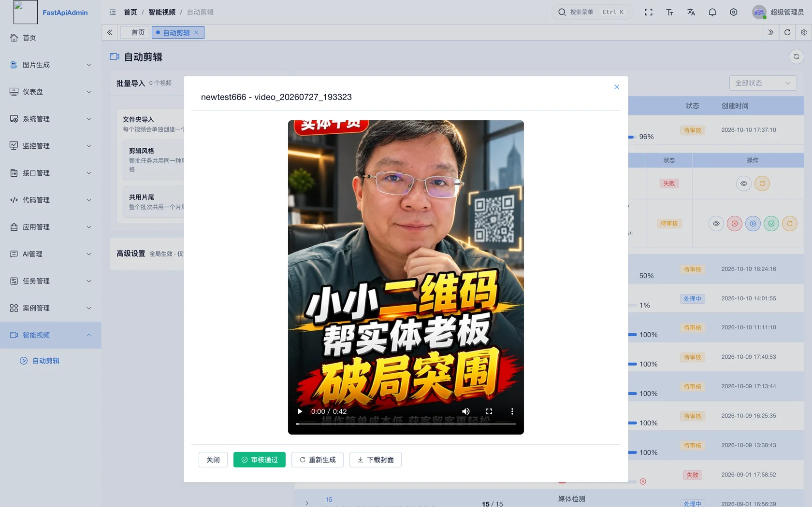
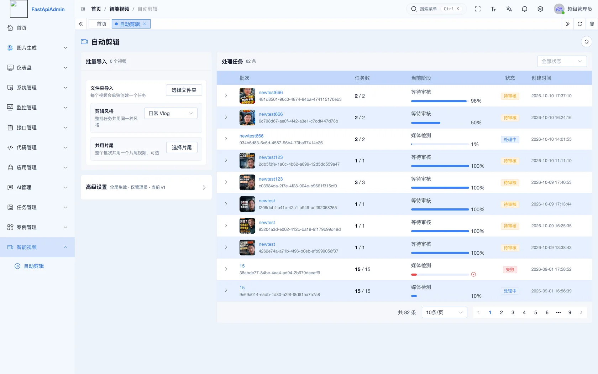
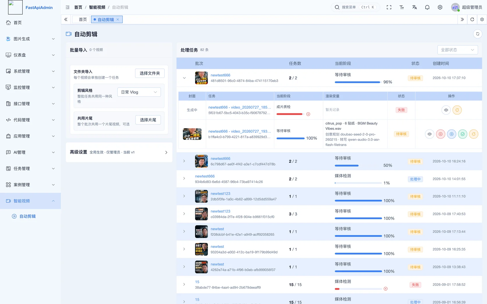
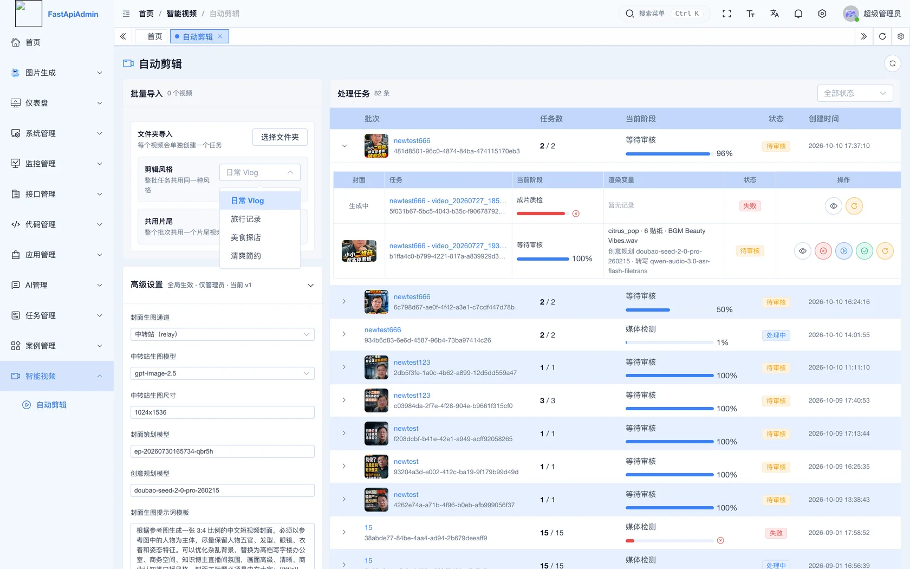
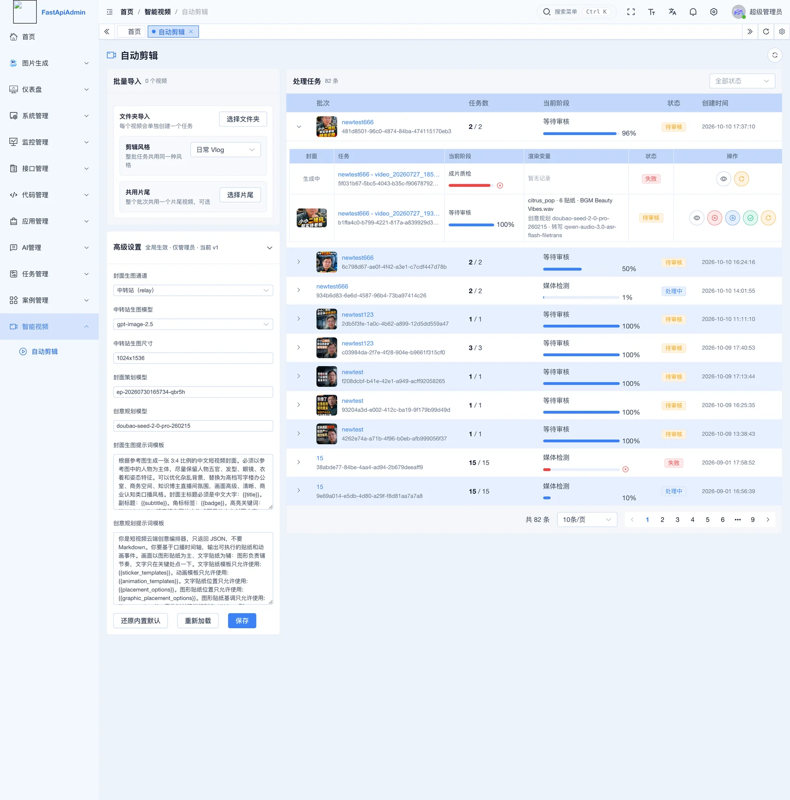
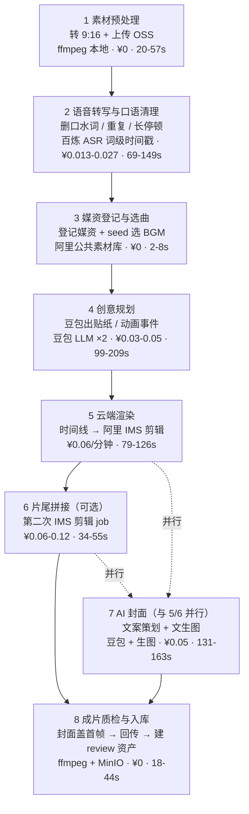

# Auto Videos · 智能剪辑流水线

> 输入一条口播视频，自动输出一条成片和一张 AI 封面。



基于 FastAPI + Vue3 的视频自动化剪辑系统。它把「语音清理 → 创意规划 → 云端渲染 → 封面生成」串成一条可断点续跑的流水线，重活全部交给云端 API，本地只做预处理和收尾。

**这是一条 workflow，不是 agent。** 每一步做什么、调用什么、花多少钱都是确定的，没有自主决策循环 —— 换句话说，它的输出可预期、成本可预算、失败可续跑。

---

## 目录

- [它做什么](#它做什么)
- [界面预览](#界面预览)
- [八阶段流水线](#八阶段流水线)
- [成本](#成本)
- [运行前准备](#运行前准备)
- [快速开始](#快速开始)
- [目录结构](#目录结构)
- [技术栈](#技术栈)
- [二次开发](#二次开发)

---

## 它做什么

**输入**：一条口播视频（任意比例，含人声）

**输出**：

- 一条竖屏 9:16 成片（含字幕、贴纸、动画、BGM、片尾）
- 一张 AI 生成的封面
- 一份可回看的质检记录

中间做了这些事：

1. 规整成 9:16 并上传对象存储
2. 语音转写拿到**词级时间戳**，据此删掉口水词、重复句、过长停顿
3. 用 LLM 规划贴纸 / 动画 / BGM 的落点
4. 把时间线提交给云端剪辑服务渲染
5. 并行生成封面（LLM 写文案 + 文生图）
6. 封面盖到首帧，回传存储，落库

**贴纸与配色的选择是确定性的**：由任务 seed 经 sha1 派生，同一个任务重跑得到同一套结果，方便复现和排查。

## 界面预览

**任务主页** — 批次导入、进度与状态一览



**批次明细** — 逐条任务的处理阶段、耗时打点与断点状态



**剪辑风格** — 整批任务共用一种风格，四种预设可选



**高级设置** — 生图通道、模型、提示词模板、字数上限与字幕样式



## 八阶段流水线



主链（1→2→3→4→5→6→8）实测 **6.5–10.6 分钟**。封面在第 5 阶段启动时并行跑，不占主链。

**关于耗时分布**：创意规划最不稳定（99–209s，近一倍方差），其次是口语清理；云端渲染稳定在 80–130s。

**断点续跑**：每个阶段的产物和游标存在独立的断点表里，任务中断后重试会从断点继续，已完成的阶段不重跑。注意 ASR 重跑会重复计费。

## 成本

**单条视频约 ¥0.22**（实测 46.8s / 54.5s 成片，含片尾）

| 项目 | 金额 | 占比 |
| --- | --- | --- |
| 阿里云 IMS 云端剪辑（2 次 job） | ¥0.12 | 55% |
| AI 封面（策划 ¥0.01 + 生图 ¥0.04） | ¥0.05 | 23% |
| 豆包 LLM（规划 + 关键词 + 封面文案，共 3 次） | ¥0.04 | 18% |
| 阿里百炼 ASR | ¥0.012–0.015 | ~6% |
| 本地 ffmpeg / 对象存储 | ¥0 | — |

**单价来源**

| 服务 | 单价 |
| --- | --- |
| 阿里云 IMS 1080P 剪辑 | **0.06 元/分钟，不足 1 分钟按 1 分钟计**（需购买【企业订阅服务】） |
| 阿里百炼 ASR | 0.00022 元/秒（按**源**音频时长计） |
| 豆包 `doubao-seed-2.0-pro` | 输入 3.2 / 输出 16 元每百万 token |
| 封面生图（中转站 `gpt-image-2.5`） | 约 0.04 元/张 |

> ⚠️ **60 秒是成本悬崖**
>
> IMS 按成片时长计费，不足 1 分钟按 1 分钟算。成片从 59s 变成 61s，片尾那个 job 会从 ¥0.06 直接跳到 ¥0.12，**整条成本 +27%**。做时长控制时，这条比单价更值得盯。

> 💡 封面生图单价从早期的 ¥0.60 降到 ¥0.04 之后，**单条总成本从 ¥0.78 降到 ¥0.22（降幅 72%）** —— 成本大头已经从封面翻转成了云端剪辑本身。

## 运行前准备

### 依赖服务

| 服务 | 版本 | 用途 |
| --- | --- | --- |
| MySQL | 8.0+ | 业务数据、任务与断点 |
| Redis | 7.0+ | 缓存、并发闸门租约 |
| MinIO 或任意 S3 兼容存储 | — | 素材、成片、封面 |
| ffmpeg | — | 本地预处理、封面首帧覆盖 |

### 需要申请的密钥

| 环境变量 | 用途 | 说明 |
| --- | --- | --- |
| `ALIYUN_ACCESS_KEY_ID` / `ALIYUN_ACCESS_KEY_SECRET` | 云端剪辑 + 对象存储 | **需开通阿里云智能媒体服务（IMS）并购买企业订阅服务**，否则无法提交渲染 |
| `ALIYUN_DASHSCOPE_API_KEY` | 语音转写（百炼） | 词级时间戳是硬依赖，换句级会静默劣化 |
| `DOUBAO_API_KEY` | 创意规划、封面文案 | 火山方舟 |
| `COVER_RELAY_API_KEY` | 封面生图（OpenAI 协议中转站） | **留空则自动回落到火山 Seedream 通道** |
| `VOLC_AK` / `VOLC_SK` | 火山引擎 | Seedream 生图、人脸融合 |

### 环境要求

- Python **>= 3.10**
- Node.js **>= 18**（pnpm >= 8）
- 数据库字符集 `utf8mb4`

## 快速开始

**1. 建库并导入初始数据**

```bash
mysql -u root -p -e "CREATE DATABASE auto_videos DEFAULT CHARACTER SET utf8mb4;"
mysql -u root -p auto_videos < backend/sql/mysql/fastapiadmin_2026-03-22_214220.sql
mysql -u root -p auto_videos < backend/sql/mysql/video_processing_menu.sql
```

**2. 配置后端环境变量**

```bash
cp backend/env/.env.prod.example backend/env/.env.dev
```

然后编辑 `backend/env/.env.dev`，至少改这几组：

- `DATABASE_HOST` / `DATABASE_PORT` / `DATABASE_USER` / `DATABASE_PASSWORD` / `DATABASE_NAME`
- `REDIS_HOST` / `REDIS_PORT`
- `MINIO_ENDPOINT` / `MINIO_ACCESS_KEY` / `MINIO_SECRET_KEY` / `MINIO_BUCKET_NAME`
- 上面表格里那些第三方密钥

**3. 启动后端**

```bash
cd backend
uv sync
uv run main.py run --env=dev
```

首次启动会自动建表并执行数据库迁移。API 文档在 `http://localhost:8001/docs`。

**4. 启动前端**

```bash
cd frontend
pnpm install
pnpm run dev
```

**5. 打开视频 Worker**

> ⚠️ **默认不消费任务。** `.env` 里 `VIDEO_WORKER_ENABLED` 默认为 `False`，必须改成 `True` 并重启后端，任务才会被自动领取和执行。

## 目录结构

```
auto-videos/
├── backend/                          # FastAPI 后端
│   ├── app/
│   │   ├── api/v1/                   # 系统模块（用户 / 角色 / 菜单 / 监控 …）
│   │   ├── plugin/                   # 业务插件（自动发现注册）
│   │   │   ├── module_video/         # ★ 智能剪辑流水线
│   │   │   ├── module_ai_image/      # AI 图片（裂变 / 风格 / 自动策略）
│   │   │   ├── module_ai/            # AI 对话
│   │   │   ├── module_task/          # 通用任务
│   │   │   ├── module_generator/     # 代码生成器
│   │   │   ├── module_application/   # 应用管理
│   │   │   └── module_example/       # 插件示例
│   │   ├── config/                   # 配置定义
│   │   ├── core/                     # 数据库 / 路由发现 / 日志 / 异常
│   │   ├── alembic/                  # 数据库迁移
│   │   └── scripts/                  # 初始化数据
│   ├── sql/                          # 初始化 SQL
│   └── env/                          # 环境变量文件
├── frontend/                         # Vue3 前端
│   └── src/
│       ├── api/                      # 接口封装
│       ├── views/                    # 页面
│       ├── components/               # 通用组件
│       └── router/                   # 路由
├── devops/                           # Nginx / Docker 部署配置
├── docs/                             # 文档
└── deploy.sh                         # 一键部署脚本
```

## 技术栈

| 层 | 技术选型 |
| --- | --- |
| 后端框架 | FastAPI / Uvicorn / Pydantic 2 |
| ORM | SQLAlchemy 2.0 |
| 数据库迁移 | Alembic |
| 定时任务 | APScheduler |
| 鉴权 | JWT + 基于角色的权限控制 |
| 前端框架 | Vue 3 / Vite / Pinia / TypeScript |
| UI 组件 | Element Plus |
| 存储 | MySQL + Redis + MinIO |
| 云端剪辑 | 阿里云智能媒体服务（IMS） |
| 语音转写 | 阿里云百炼（词级时间戳） |
| 文案与规划 | 豆包（火山方舟） |
| 封面生图 | OpenAI 协议中转站 / 火山 Seedream |
| 部署 | Docker / Nginx / Docker Compose |

## 二次开发

项目采用**插件化架构**，业务代码集中在 `backend/app/plugin/` 下。

系统会自动扫描 `app/plugin/module_*/**/controller.py` 中定义的 `APIRouter` 并注册，**目录名即路由前缀** —— 新增一个 `module_xxx/` 目录，其中的 `controller.py` 就会被自动挂到 `/xxx` 下，不需要手写注册代码。

前端页面放在 `frontend/src/views/module_xxx/`，菜单通过后端配置下发。

---

## 说明

- 本项目基于 [FastapiAdmin](https://gitee.com/fastapiadmin/FastapiAdmin) 二次开发，基础框架（权限、菜单、代码生成器等）来自上游。
- 智能剪辑流水线（`module_video`）为原创实现。
- License: [MIT](LICENSE)
